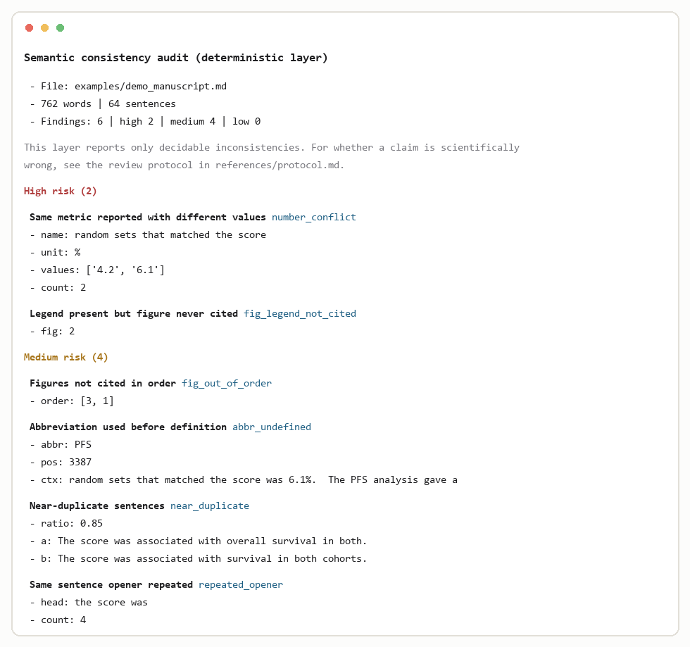

# paper-preflight

English | [简体中文](README.zh-CN.md)

Pre-submission audit for scientific manuscripts. Catches the errors that get papers
returned at technical check — figures cited out of order, abbreviations used before
definition, the same metric reported with two different values — and measures how far
the prose sits from a corpus of published writing.

Three layers, deliberately separated:

| Layer | What runs | What it catches |
|---|---|---|
| **L1 consistency** | `semantic_audit.py` | figure numbering and citation order, numeric conflicts, undefined abbreviations, near-duplicate sentences, repeated openers, tensions between the limitations and the body |
| **L2 style** | `style_audit.py` | sentence-length distribution, connective density and variety, hedging |
| **L3 meaning** | `references/protocol.md` | claims stronger than their evidence, cross-section contradictions, terminology drift — a workflow, not a script |

The separation is the point. A script cannot tell you that a sentence is scientifically
wrong. Pretending otherwise is worse than not trying.

## Install

No installation. Python 3.9+ standard library only.

`python-docx` is needed only if you audit `.docx` rather than `.md`:

```bash
pip install python-docx
```

## Use

```bash
# L1 — exit code 1 if anything high-risk is found
python scripts/semantic_audit.py --file manuscript.md --out report_L1.md

# L2 — compares against assets/baseline.json
python scripts/style_audit.py --file manuscript.md --out report_L2.md
```

For `.docx`, pass the file directly; legends and tables are read too.

## What it looks like



`examples/demo_manuscript.md` is a short paper with defects planted on purpose.
Running L1 on it gives:

```
命中 6 条（高 2 / 中 4 / 低 0）
  HIGH   同名指标数值冲突        number_conflict        4.2 vs 6.1 %
  HIGH   有图注但正文未引用      fig_legend_not_cited   Fig. 2
  MEDIUM 图号引用顺序错乱        fig_out_of_order       [3, 1]
  MEDIUM 缩写首次出现未定义      abbr_undefined         PFS
  MEDIUM 近重复句                near_duplicate         ratio 0.85
  MEDIUM 同一句式反复起句        repeated_opener        "the score was" x4
```

Reports are written in Chinese by default. Every finding carries a severity, the
sentence or figure number involved, and enough context to locate it.

## The four checks that matter most

**Figure order.** Journals number figures in order of first citation. Renumbering a
manuscript — which happens every time a figure is added — silently breaks this. A paper
can pass every word-level check and still be returned for it.

**Numeric conflict.** The same quantity reported twice with different values. Usually a
value updated in one place and not another.

**Abbreviation defined late.** Defined in the abbreviation list but used in the Results
twenty pages earlier. The list counts as a definition for copy-editing, not for a
reader.

**Repeated opener.** `We therefore repeated …` opening six sentences in a row. Connective
*density* looks normal; a reader notices by the second one.

## Style baseline

`assets/baseline.json` was computed from 16 open-access full texts (5,715 sentences) in
bioinformatics. Measured with the same sentence splitter the checker uses, so the
comparison is like-for-like:

| Metric | Baseline | Suggested ceiling |
|---|---:|---|
| mean sentence length | 21.9 words | 20–23 |
| sentences ≥ 35 words | 9.9% | ≤ 12% |
| sentences ≤ 15 words | 31.5% | 28–33% |
| connectives per 100 sentences | 21.2 | ≤ 22 |
| connective types | 38 | see note below |

**Connective variety is not a vocabulary problem.** It comes from rhetorical slots —
an aim sentence at the end of the introduction, a contribution sentence and a separate
limitations paragraph in the discussion. Papers that lack those slots score low on
variety no matter which synonyms you swap in. `references/protocol.md` §2 explains this.

Different field? Recompute the baseline with your own corpus before trusting the
comparison (`references/protocol.md` §1). Two different sentence splitters will give you
two different numbers for the same paper.

## Limitations, stated plainly

- **Rules are heuristics and will produce false positives.** Gene symbols look like
  undefined abbreviations; sample sizes look like numeric conflicts. Stop lists and
  frequency filters cut most of it; some judgement remains.
- **The baseline is one field.** Clinical trials and reviews need their own.
- **It cannot judge science.** It reports inconsistency, never incorrectness.
- **The most expensive errors are still found by reading.** In the papers this was built
  from, the three defects that mattered most — a lowercase sentence start left behind by
  a split, a paragraph duplicating a section heading verbatim, an opener repeated six
  times — were caught by a human reading the text, not by any check here. Run the
  scripts to save attention, then read.

## Files

```
scripts/semantic_audit.py   L1
scripts/style_audit.py      L2
assets/baseline.json        corpus baseline
references/protocol.md      L3 workflow
examples/                   demo manuscript and generated reports
```

## License

MIT. See `LICENSE`.
